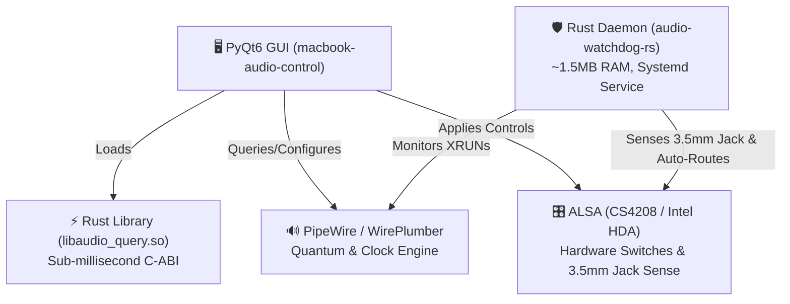

# 🍎 MacBook Audio Control Center

[](https://opensource.org/licenses/MIT)
[](https://www.rust-lang.org/)
[](https://www.python.org/)
[](https://pipewire.org/)
[-lightgrey.svg)]()

A comprehensive, high-performance audio management suite and GUI specifically engineered for Apple MacBooks (Intel Broadwell-U / Haswell / Skylake with Cirrus Logic CS4208 codecs) running Linux with **PipeWire**, **WirePlumber**, and **ALSA**.

---

## 🎯 The Problem

When running modern Linux (CachyOS, Arch, Fedora, Ubuntu) on Apple MacBooks:
1. **Audio Lag & Buffer Dropouts (XRUNs)**: Switching to low-latency or the `pro-audio` profile causes severe sound stutters, jitters, and broken pipe errors due to unaligned ALSA period sizes and buffer headrooms.
2. **The "Multi-Output" Jack Bug**: Because `pro-audio` bypasses ALSA UCM profiles, the Cirrus Logic CS4208 DAC outputs audio simultaneously to **both** internal speakers and connected 3.5mm headphones.
3. **No Native Hardware Switch GUI**: Standard desktop volume sliders do not expose Cirrus Logic hardware DAC controls, Auto-Mute modes, or live PipeWire quantum / bitrate switching.

---

## 💡 The Solution

**MacBook Audio Control Center** solves this with a multi-tiered architecture:

- 🎛️ **Modern PyQt6 / PyQt5 GUI**: Switch buffer sizes (32 to 4096), clock rates (44.1 kHz to 192 kHz), card profiles, HDMI audio, and Bluetooth codecs with live bitrate and latency calculations.
- ⚡ **Rust Acceleration Engine (`audio-query-rs`)**: Native C-ABI library querying ALSA mixer nodes and PipeWire in sub-millisecond time (<0.2 ms), eliminating process-fork overhead.
- 🛡️ **Ultra-Lightweight Background Watchdog (`audio-watchdog-rs`)**: A background daemon (~1.5 MB RAM) that detects audio dropouts, prevents buffer crashes, and listens for 3.5mm jack plug/unplug events.
- 🎧 **Smart Exclusive Auto-Routing**:
  - **Headphones Plugged In**: Automatically mutes the internal laptop speakers and routes audio exclusively to headphones.
  - **Headphones Unplugged**: Automatically unmutes and returns audio to internal speakers.
  - **Bluetooth Connected**: WirePlumber automatically prioritizes and routes sound to the Bluetooth device.
  - **Simultaneous Output Toggle**: Optional manual toggle to output through both speakers and headphones simultaneously if desired.

---

## 🖼️ Application Overview

### Functional Tabs:
1. **⚡ Dashboard & Presets**: System overview with live latency, PCM bitrate, and one-click presets:
   - *Pro Audio Fix (Baseline)*: Safe, jitter-free 1024 buffer @ 48kHz with period-size fix.
   - *Gaming / Low Latency (5.3ms)*: 256 buffer size for fast competitive response.
   - *DAW / Musician Ultra-Fast (2.7ms)*: 128 buffer size for zero-latency recording.
   - *Studio High Sample Rate (96kHz)*: 24-bit 4.6 Mbps studio quality.
   - *Audiophile Hi-Res (192kHz)*: 9.2 Mbps lossless playback.
   - *Daily / Stable Analog Duplex*: Standard balanced configuration.
   - *High-Fidelity Bluetooth A2DP*: LDAC HQ (990k) and SBC-XQ optimized.
2. **⏱️ Buffer Size, Bitrate & Clock**: Live quantum selection (32 to 4096) and sample rates (44.1k to 192k) with uncompressed PCM bitrate monitoring.
3. **🎛️ Audio Profiles**: Seamless switching between Pro Audio, Analog Stereo Duplex, and custom profiles.
4. **🔊 Hardware & Devices**: ALSA hardware master volume, speaker volume, headphone volume, smart jack routing status, and simultaneous multi-output toggle.
5. **📶 Bluetooth Audio Hub**: Real-time connected device manager and LDAC / SBC-XQ high-bitrate rules.
6. **🔍 Diagnostics & Logs**: Live system diagnostics, XRUN counters, and PipeWire journal inspector.

---

## 🚀 Quick Start (One-Command Installation)

### 1. Clone the repository
```bash
git clone https://github.com/Blackx16/macbook-audio-control.git
cd macbook-audio-control
```

### 2. Run the installer
```bash
./install.sh
```

The installer will:
- Check system prerequisites.
- Compile the Rust acceleration and watchdog modules.
- Install binaries to `~/.local/bin` and backend files to `~/.local/share/macbook-audio-control`.
- Install the `.desktop` launcher in your application menu.
- Deploy optimized WirePlumber (`51-pro-audio-fix.conf`) and PipeWire (`10-quantum.conf`) drop-ins.
- Enable and start the background watchdog systemd user service (`macbook-audio-watchdog.service`).
- Run the 12-point automated verification suite.

---

## 📋 System Requirements

| Component | Requirement |
|-----------|-------------|
| **OS** | Linux (Arch Linux, CachyOS, Fedora, Ubuntu 22.04+, Debian 12+) |
| **Audio Server** | PipeWire 0.3+ / 1.0+ with WirePlumber |
| **Python** | Python 3.9+ with `PyQt6` (or `PyQt5`) |
| **Compiler** | Rust & Cargo (to build fast-path modules) |
| **Hardware** | MacBook Pro / MacBook Air (CS4208 codec), or any Linux laptop with ALSA/PipeWire |

### Package Installation by Distribution:

**Arch Linux / CachyOS:**
```bash
sudo pacman -S python python-pyqt6 rust cargo alsa-lib alsa-utils pipewire wireplumber
```

**Fedora:**
```bash
sudo dnf install python3 python3-pyqt6 rust cargo alsa-lib-devel alsa-utils pipewire wireplumber
```

**Ubuntu / Debian:**
```bash
sudo apt install python3 python3-pyqt6 rustc cargo libasound2-dev alsa-utils pipewire wireplumber
```

---

## 🖥️ Command-Line Interface (CLI)

The `macbook-audio-control` command can also be operated entirely from your terminal or shell scripts:

```bash
# Print current audio state, quantum, bitrate, and jack status
macbook-audio-control --status

# Run the 12-point system verification test suite
macbook-audio-control --test

# Apply a preset directly
macbook-audio-control --preset pro_audio_fix
macbook-audio-control --preset gaming_low_latency
macbook-audio-control --preset audiophile_192k

# Adjust live buffer size (quantum)
macbook-audio-control --quantum 512

# Trigger one-shot intelligent jack auto-routing
macbook-audio-control --route

# Enable or disable simultaneous output from CLI
macbook-audio-control --simultaneous off
macbook-audio-control --simultaneous on
```

### Interacting with the Background Watchdog (`audio-watchdog-rs`):

```bash
# Query watchdog status and recent XRUN / dropout counts
audio-watchdog-rs --status

# Inspect background systemd service status
systemctl --user status macbook-audio-watchdog.service

# View background watchdog service logs
journalctl --user -u macbook-audio-watchdog -f
```

---

## 🏗️ Architecture



- **`audio_backend.py`**: High-level controller handling PipeWire metadata, WirePlumber configuration files, and PyQt GUI.
- **`rust/audio-query-rs/`**: Pure Rust ALSA & PipeWire inspector compiled to a dynamic library (`libaudio_query.so`) and CLI binary.
- **`rust/audio-watchdog-rs/`**: Standalone daemon monitoring `pipewire` user journal for buffer underruns and checking ALSA `Headphone Jack` state every 500ms.
- **`configs/`**: Clean drop-in configuration files for WirePlumber rules, PipeWire quantum properties, and user systemd services.

---

## 🧪 Verification & Automated Testing

You can run the full test suite anytime with:

```bash
make test
# OR
macbook-audio-control --test
```

Expected output:
```text
>>> Running MacBook Audio Control Center Verification Suite...
[1/10] Testing PipeWire live metadata query...               OK
[2/10] Testing saved PipeWire & WirePlumber config readers... OK
[3/10] Testing audio bitrate calculations & latency formulas...OK
[4/10] Testing wpctl status parser...                        OK
[5/10] Testing audio cards & disambiguation (CS4208 vs HDMI).OK
[6/10] Testing Broadwell HDMI audio status & control...       OK
[7/10] Testing ALSA Cirrus Logic CS4208 mixer controls...     OK
[8/10] Testing Preset definitions & data validity...          OK
[9/10] Testing Bluetooth device scanning...                  OK
[10/12] Testing Headless Qt GUI Instantiation...             OK
[11/12] Testing Headphone Jack state query & Settings...     OK
[12/12] Testing Smart Exclusive Auto-Routing engine...       OK
>>> All 12 verification tests PASSED successfully!
```

---

## 🗑️ Uninstallation

If you ever wish to remove the control center:

```bash
./uninstall.sh
```

This stops the background watchdog, removes installed binaries and desktop files, and optionally asks whether to revert PipeWire and WirePlumber configuration drops.

---

## 📄 License

This project is open-source software licensed under the [MIT License](LICENSE).

Authored by **[Blackx16](https://github.com/Blackx16)**.
